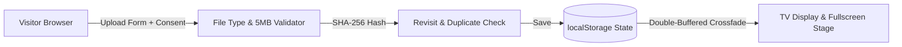

# System Architecture (WebApp)

## Tech Stack
- **Frontend**: Responsive HTML5, Tailwind CSS, and Vanilla JavaScript
- **Hashing & State**: Web Crypto API (`SHA-256`) + `localStorage`

## System Diagram

