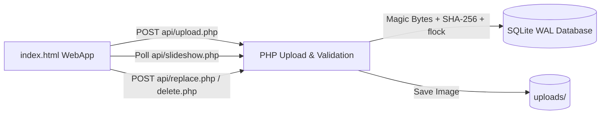

# System Architecture

## Tech Stack
- **Frontend**: Responsive HTML5, Tailwind CSS, Vanilla JavaScript (`index.html`)
- **Backend**: PHP 8+ REST endpoints (`api/upload.php`, `api/slideshow.php`, `api/replace.php`, `api/delete.php`, `api/reset.php`)
- **Database**: SQLite (`PDO_SQLITE`) in WAL mode with `flock` concurrency locking

## Data Model
- `visitors(id INTEGER PRIMARY KEY, name TEXT, identifier TEXT UNIQUE, consent_given INTEGER, created_at DATETIME)`
- `photos(id INTEGER PRIMARY KEY, visitor_id INTEGER FK, filename TEXT UNIQUE, file_hash TEXT, created_at DATETIME)` with `UNIQUE(visitor_id, file_hash)`

## System Diagram

